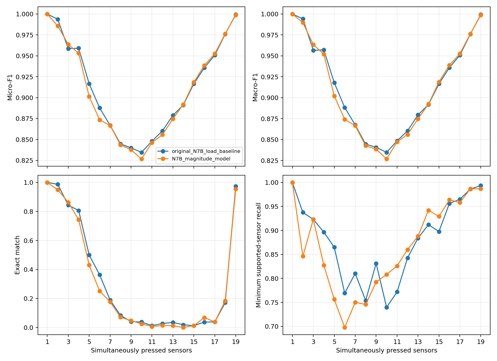
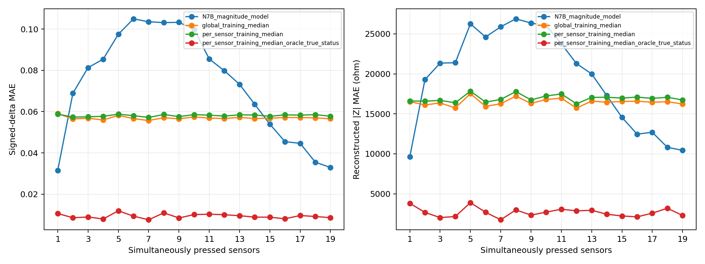
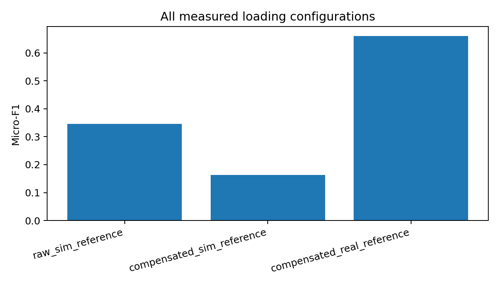
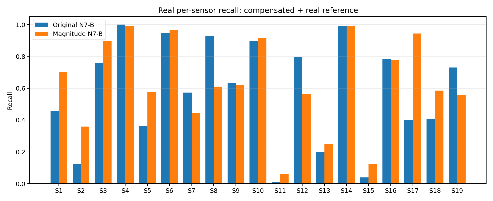

# E2 Impedance Sensor Network: Simulation and Sim-to-Real Study

This repository archives a completed research exploration of a distributed impedance sensor network with 19 sensing elements. The study uses complex boundary impedances between 14 electrical nodes to infer which sensors are pressed and to investigate continuous load and intrinsic-impedance magnitude regression.

The complete network provides 91 unordered boundary measurement pairs. The reduced **N7-B** topology uses 11 selected pairs and three features per pair: impedance-magnitude ratio, sine of relative phase, and cosine of relative phase. A shared residual CNN predicts 19 pressed-state logits and 19 continuous outputs.

**Status: completed research exploration / archived.** The repository preserves the implementation, principal results, and negative findings for transparency and reproducibility. It does not claim experimentally validated quantitative intrinsic-impedance reconstruction.

## Research objectives

1. Classify the pressed/unpressed state of each of 19 sensors.
2. Regress continuous applied load in kilograms in the original dual-task model.
3. Test signed relative intrinsic-impedance magnitude change as an alternative regression target.
4. Diagnose simulation-to-real transfer, parasitic compensation, and unloaded-reference alignment.

The signed magnitude target is

\[
\Delta_s = \frac{|Z_s|-|Z_{s,0}|}{|Z_{s,0}|}.
\]

It is dimensionless, signed, and was not clipped. The experimental model used an unconstrained linear output, which also permitted physically invalid predictions with \(1+\hat\Delta_s<0\).

## Method summary

- 14 nodes and 19 physical sensor edges.
- 91 candidate boundary impedance measurements.
- N7-B selection of 11 boundary pairs.
- Input tensor: `11 × 3` per sample.
- Features: `|Z|/|Z0|`, `sin(angle(Z/Z0))`, and `cos(angle(Z/Z0))`.
- Dataset: 20,000 simulated samples, including 19,975 loaded and 25 unloaded samples.
- Loaded samples contain between 1 and 19 simultaneously pressed sensors.
- Shared residual 1-D CNN: channels `3 → 64 → 128 → 256`, GroupNorm, ReLU, pooling, and two `256 → 64 → 19` heads.
- Exact duplicate 91-dimensional inputs are assigned atomically to a single partition.
- Model checkpoints and classification thresholds are selected using simulation validation data only.
- Real-data evaluation freezes both neural networks and their thresholds.

See [docs/methodology.md](docs/methodology.md) for the complete data, splitting, training, compensation, and reproducibility description.

## Simulation classification results

Both frozen N7-B models were evaluated on identical simulation test samples for every pressed-sensor count from 1 through 19. The magnitude-regression target did not consistently improve classification over the original load-regression model.

- One pressed sensor was classified perfectly by both models.
- Counts 5–13 were the most difficult region, with Micro-F1 generally around 0.83–0.90.
- Micro-F1 rose again near 19 pressed sensors, partly because positive labels dominate those samples.
- Exact Match Accuracy was extremely low for several intermediate counts even when Micro-F1 remained high.

Selected magnitude-model results:

| Pressed sensors | Micro-F1 | Exact Match Accuracy |
|---:|---:|---:|
| 1 | 1.000 | 1.000 |
| 4 | 0.953 | 0.744 |
| 6 | 0.874 | 0.252 |
| 10 | 0.827 | 0.025 |
| 14 | 0.892 | 0.000 |
| 19 | 0.999 | 0.954 |



The complete paired table is available in [classification_metrics_by_pressed_count_1to19.csv](results/simulation/classification_metrics_by_pressed_count_1to19.csv).

## Intrinsic magnitude reconstruction

The magnitude CNN failed to outperform the deployable global training-set median in **13 of 19** pressed-count conditions. It performed better primarily at one pressed sensor and at counts 15–19, while counts 2–14 generally favored the constant median.

The unconstrained output produced negative reconstructed magnitudes in many simulation entries. Relative errors were also very large because some simulated pressed magnitudes approach zero. These results do not demonstrate useful quantitative intrinsic-magnitude reconstruction.



See [magnitude_metrics_by_pressed_count_1to19.csv](results/magnitude/magnitude_metrics_by_pressed_count_1to19.csv) for signed-change, reconstructed-ohm, relative-error, and invalid-prediction metrics.

## Frozen-model real-data validation

The diagnostic archive contains 804 real 100 kHz samples with all 91 boundary pairs. Measured configurations cover 1–11 pressed sensors; counts 12–19 were not measured. Counts 7 and 11 contain only one sample and are not statistically representative.

Three preprocessing conditions were evaluated without training, fine-tuning, or real-label threshold selection:

| Condition | Original N7-B Micro-F1 | Magnitude N7-B Micro-F1 |
|---|---:|---:|
| Raw + simulation reference | 0.321 | 0.346 |
| Compensated + simulation reference | 0.179 | 0.164 |
| Compensated + real reference | 0.631 | 0.661 |



The compensated real-reference condition was best, but remained far below simulation performance and showed strong sensor-specific failures. The independent contribution of parasitic compensation cannot be determined because the raw + real-reference condition was not evaluated.



The compensated real reference differed from the simulation reference by a relative L2 distance of 0.927. Under compensated + real reference, only 1.44% of feature components were outside the simulation 0.5–99.5% interval, compared with 55.39% for compensated + simulation reference. This shows that reference alignment strongly changes feature-domain overlap; it does not prove physical de-embedding accuracy.

No independent real intrinsic-impedance ground truth is available. Real magnitude outputs are therefore consistency diagnostics only; no real magnitude MAE or RMSE is claimed.

## Physical limitations

- Continuous-load behavior transfers normalized resistance/capacitance response information measured at 5 kHz to E2 unloaded baselines at 100 kHz. This frequency transfer is not independently validated.
- The 20,000-sample dataset is mathematically consistent with its implemented grounded nodal forward model, but it is not experimentally validated quantitative 100 kHz ground truth.
- Some simulated intrinsic magnitudes approach zero under load.
- The final E2 dataset excludes parasitic admittance.
- The historical parasitic calibration is a 91-path parallel-admittance approximation. Its file does not embed pair labels; ordering follows project code lineage.
- After inverse compensation, 23.42% of real boundary entries had nonpositive real inferred intrinsic admittance.
- Real measurements exhibit substantial reference, sensor, and feature-domain shift.
- Private source measurements, calibration files, synthetic datasets, and checkpoints are intentionally excluded from Git.

## Repository contents

```text
scripts/
  simulation/     E2 dataset generator and shared response/forward model
  training/       original and magnitude N7-B training plus inference definitions
  diagnostics/    load correlation, physics audit, and frozen 1–19 analysis
  validation/     frozen real-data compensation/reference diagnostic
results/
  simulation/     paired classification tables and figure
  magnitude/      magnitude/baseline table and figure
  real_validation/ compact real metrics, diagnostics, and figures
docs/
  methodology.md
  repository_preparation.md
```

The organized scripts are archival copies. Original root-level research scripts remain preserved because several use script-relative paths. External inputs must be supplied explicitly where defaults refer to the original private workstation layout.

## Reproduction boundaries

The lightweight tables and figures in this repository reproduce the reported conclusions without exposing private measurements or large binary artifacts. Re-running generation, training, or real validation requires external files described in [docs/methodology.md](docs/methodology.md). The repository alone is not a complete public data release.
